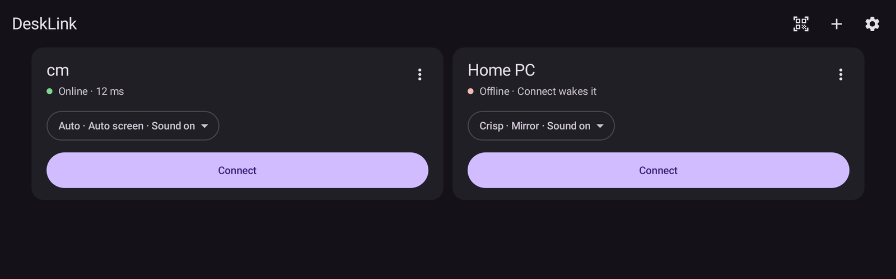
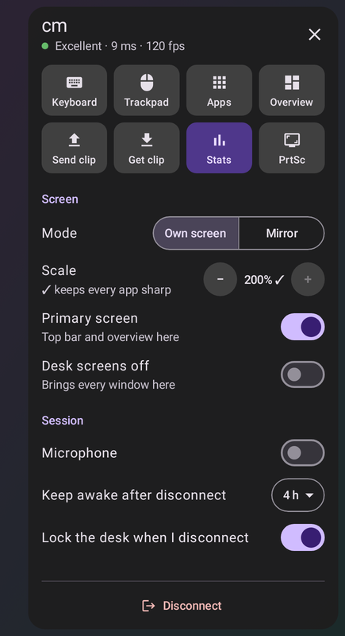
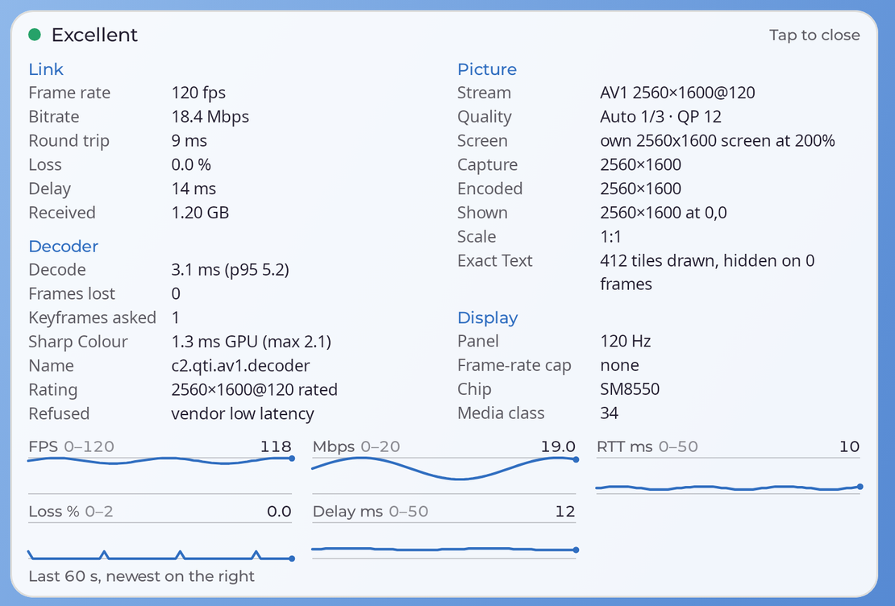
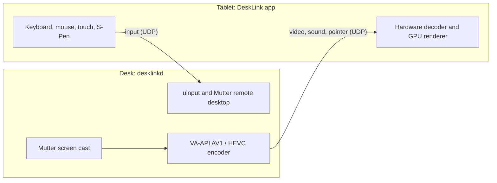

# DeskLink

DeskLink shows a Fedora GNOME desktop on an Android tablet and sends the
tablet's keyboard, mouse, touchscreen and S-Pen back to it. The desktop's GPU
encodes the screen at the tablet's full resolution and up to 120 frames a
second, and the tablet decodes it in hardware, so text stays sharp. It works
at home, at the office and over a VPN, and a laptop client shows the same
desktop in a window.

The desktop side needs GNOME on Wayland and a GPU with VA-API encoding; the
app runs on Android 12 or later. DeskLink is developed on Fedora with an AMD
Radeon RX 7800 XT and a Galaxy Tab S9.



## Features

### A sharp picture at 120 frames a second

desklinkd records the screen through GNOME's own screen-cast interface and
encodes it on the GPU as AV1 or 10-bit HEVC, with a fine quantizer that keeps
the edges of text intact. The tablet decodes it in its hardware decoder's
low-latency mode and shows it pixel for pixel at the panel's 120 Hz.

Two optional steps on the tablet's GPU go further. **Sharper colours**
rebuilds the colour edges that video compression softens, so coloured text
and syntax highlighting stay crisp. **Exact text when still** sends the exact
pixels of the parts of the screen that stop changing, such as a page you are
reading, and draws them over the video, so still text looks exactly as it
does at the desk.

The **Auto** quality preset keeps the full resolution and adapts to each
connection. On a poor link it lowers the frame rate first, then the detail,
and the size only as a last resort, and it returns to full quality once the
link recovers. Sharp, Crisp, Balanced and Office Saver are fixed presets.

### The tablet's own screen, or the desk's

If the computer was locked when you connected, the tablet gets a screen of
its own: a virtual monitor of the tablet's size and orientation, at 200 %
with GNOME's top bar, readable at arm's length. If someone is using the
computer, DeskLink mirrors the monitor closest to the tablet's shape and
changes nothing at the desk.



A three-finger tap, or the pill at the screen's edge, opens the session
sheet. From there you can switch between the two screens, change the scale,
give the top bar and the overview back to the desk when the tablet is an
extra monitor there, or turn the desk's monitors off so every window comes
to the tablet. It also
holds the on-screen keyboard, a trackpad, GNOME's app grid and overview, the
clipboard and the connection's statistics.

When you disconnect, the tablet's screen goes away, its windows move back to
your monitors and keep running, and the desk's monitors come back on.

<br clear="right">

### Input

The tablet draws the desk's pointer itself and moves it the moment your
mouse, finger or S-Pen moves, in the shapes the desk uses (arrow, text
cursor, resize arrows), instead of waiting for the next video frame. A mouse
moves it with the speed and acceleration GNOME gives your mouse at the desk.

On the touchscreen a tap clicks where you touch, and one or two fingers
scroll the window under them, as on a phone: the page stays under your
fingers and keeps going when you flick. Holding a finger still for half a
second right-clicks when you lift it, or selects text and moves windows when
you then drag. Three fingers swiped up open GNOME's overview, and swiped left
or right change workspace. When the tablet mirrors a monitor, two fingers
pinch to zoom in. A Trackpad mode turns the touchscreen into a touchpad
instead.

The S-Pen draws with pressure and tilt, hovers, and right-clicks with its
button, and it holds still while you double-tap a word. A keyboard cover
works as the desk's keyboard; with one switch in Android's accessibility
settings it also sends Win, Win+key shortcuts and Alt+Tab, which Android
otherwise keeps for itself. The on-screen keyboard types any character the
desk's keyboard layout has, accents, other alphabets and emoji included.

### Sound, microphone, clipboard and files

While you are connected, the desk's sound plays on the tablet instead of the
desk's speakers, and the tablet's microphone can be the desk's microphone for
calls. Text and images go both ways: what you copy on the desk with a
shortcut is on the tablet's clipboard, and the tablet's clipboard reaches the
desk when you come back to DeskLink. Files shared to DeskLink from any
Android app are saved in the desk's Downloads folder, with their paths on the
desk's clipboard and a notification that opens them in Files. The Apps
button starts any of the desk's applications.

### Leaving the computer unattended

Connecting unlocks the computer and keeps it awake for the session. When you
disconnect it can lock again, stay awake for a while, or suspend. A computer
that is asleep is woken with Wake-on-LAN when you tap Connect, and after a
reboot GDM can log you in by itself so desklinkd is ready, with the screen
locked until you connect. systemd restarts desklinkd if it stops responding.
Since connecting unlocks the desk, the app can ask for your fingerprint or
PIN first.

### Home, office and VPN

You pair a computer once. The app remembers every address the computer has,
at home, at the office or over a VPN, tries them all and uses whichever
answers first, and finds the computer on any local network by itself. Auto
quality remembers each network's last level, a dropped connection reconnects
on its own, and the app warns before streaming over a metered network.

### Connection statistics



The stats overlay shows the frame rate, bitrate, round trip, packet loss and
the delay from capture to screen, how long the tablet takes to decode a
frame, the stream's size and quality, and the panel's refresh rate, with
graphs of the last minute. **Test connection** in a computer's menu checks
the network path before you connect, and **Share logs** in the settings
sends the app's logs.

### Pairing and encryption

`desklinkd pair` at the desk shows a QR code with the computer's address, a
one-time PIN and its certificate's fingerprint. Scanning it pairs the tablet
with that computer and no other, and from then on the tablet connects
without anyone at the desk. Control messages travel over TLS 1.3, and video,
sound and input are encrypted with ChaCha20-Poly1305 under keys from the
pairing. [docs/security.md](docs/security.md) describes what pairing protects
against.

### A laptop client

`desklink` shows the same desktop in a GTK window on a Fedora laptop. The
laptop's own mouse pointer maps onto the desktop, its keyboard goes to the
desktop, sound plays on the laptop, and **Send file…** puts files in the
desk's Downloads folder.

## How it works



desklinkd is a Go daemon that runs in your GNOME session as a systemd user
service. It records the screen through Mutter's screen-cast API, encodes it
with GStreamer on the GPU, and sends video, sound and the pointer's position
as encrypted UDP datagrams of at most 1280 bytes, with parity packets that
repair a lost one without a resend. Input comes back the same way and is
injected through `/dev/uinput` and Mutter's remote-desktop session. Pairing,
settings and the clipboard use a TLS 1.3 WebSocket.

The Android app, written in Kotlin with Jetpack Compose, decodes with
`MediaCodec` onto a `SurfaceView` and sends input as soon as Android reports
it. The laptop client is in the same Go module as the daemon and shares its
protocol and crypto.

## Install

Each [release](https://github.com/jsnjack/desklink/releases) has two Fedora
RPMs and the Android app:

```bash
# On the desktop (enables and starts desklinkd for every graphical session):
sudo dnf install ./desklinkd-*.x86_64.rpm

# On a laptop:
sudo dnf install ./desklink-*.x86_64.rpm

# For the tablet, with USB debugging on:
adb install -r desklink.apk
```

The desklinkd package also gives the user at the computer access to
`/dev/uinput` for input injection, and turns on Wake-on-LAN for wired
connections. HEVC encoding needs RPM Fusion's `mesa-va-drivers-freeworld`;
AV1 works with Fedora's own Mesa.

To update the tablet app, open https://jsnjack.github.io/android-apps/ on the
tablet and tap **Install** under DeskLink; your computers and pairings stay.

### From source

```bash
# The desktop:
sudo dnf install golang gstreamer1-devel gstreamer1-plugins-base-devel \
    pipewire-gstreamer gstreamer1-plugins-bad-free wl-clipboard
make install-host
systemctl --user enable --now desklinkd

# The tablet, connected with adb:
make install

# A laptop:
sudo dnf install gstreamer1-plugin-gtk4
make install-laptop
```

`make install-host` installs `~/.local/bin/desklinkd` and the systemd user
unit. Input injection also needs the udev rule the command prints, unless the
desklinkd RPM is installed.

Settings live in `~/.config/desklink/config.json`; the defaults listen on
ports 9443 (TCP) and 9444 (UDP) and put the address of the default route in
the pairing QR code. See [docs/desktop.md](docs/desktop.md#configuration).

## Pair

At the desk, run:

```bash
desklinkd pair
```

It prints a QR code and, below it, the same pairing code as a line of JSON,
valid for five minutes, and says whether Wake-on-LAN is ready.

- On the tablet, tap **Scan QR** (or **Pair again** in a computer's menu) and scan
  the QR code.
- On a laptop, choose **Pair with code** in DeskLink and paste the line of
  JSON, or run `desklink pair '<JSON>'`.

Neither client accepts the PIN alone: anyone who answered a PIN-only pairing
could work out the PIN offline and then pair with the real desktop.

To send Win, Win+key and Alt+Tab from a keyboard cover, open the app's
settings (the gear), tap **Accessibility** next to "Keyboard shortcuts" and
switch on "DeskLink keyboard shortcuts"; it only takes keys while a session
is on screen.

`desklinkd peers` lists the paired devices and when they last connected;
`desklinkd peers remove <name or ID>` forgets one. **Forget** on a computer
in the app or the laptop client does the same from the device's side.

## Connect

Choose a quality preset and tap **Connect**. On a laptop, open DeskLink and
choose **Connect**; Ctrl+Alt+Shift+F toggles fullscreen and Ctrl+Alt+Shift+Q
disconnects ([docs/laptop.md](docs/laptop.md)).

## Reach the desktop when it sleeps or after a reboot

- A computer that does not answer is woken: the app sends Wake-on-LAN
  packets and connects once it is up (up to 90 seconds). This needs a wired
  connection; the RPM turns Wake-on-LAN on in NetworkManager, and waking
  from power-off also needs it enabled in the BIOS.
- desklinkd runs inside your GNOME session, so after a reboot, a crash or a
  logout someone has to log in. Run `desklinkd autologin on` once at the
  desk: GDM then logs you in at boot and 10 seconds after its login screen
  appears. desklinkd locks the screen as soon as the session starts, and
  connecting unlocks it as usual. See
  [docs/desktop.md](docs/desktop.md#staying-up) for the trade-offs.

## Development

See [AGENTS.md](AGENTS.md) for the code map and commands, and `docs/` for
the protocol, desktop integration, Android client, laptop client and
security model. `make check` and `make android-check` run every test;
`make screenshots` renders the app's screens, including the ones above.
