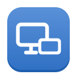
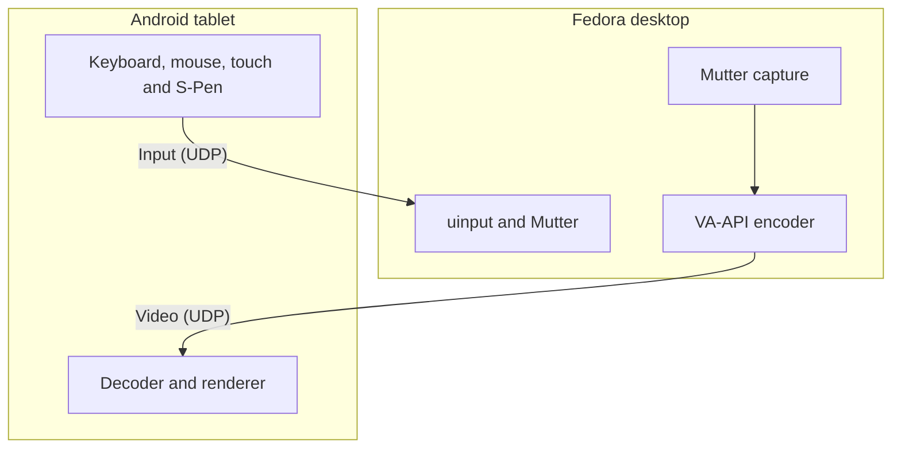

<p align="center">
  
</p>

<h1 align="center">DeskLink</h1>

<p align="center"><strong>Your GNOME desktop on your tablet. Pixel-exact.</strong><br>
Encoded on your GPU at 120 Hz. No account, no cloud.</p>

<p align="center">
  <a href="https://github.com/jsnjack/desklink/releases/latest"></a>
  <a href="LICENSE"></a>
  <a href="#install"></a>
  <a href="https://jsnjack.github.io/android-apps/"></a>
</p>

<p align="center">
  <a href="#install">Install</a> · <a href="#pair">Pair</a> · <a href="#everything-it-does">Features</a> ·
  <a href="#security">Security</a> · <a href="#building-from-source">Build</a>
</p>


I built DeskLink so I could keep working in my GNOME session from a tablet.
I wanted text to look as sharp as it does at the desk and the mouse, keyboard,
touchscreen and S-Pen to feel like part of the desktop. DeskLink streams a
Fedora GNOME desktop to an Android tablet over the local network or a VPN.
It also has a Fedora laptop client that shows the same desktop in a window.

## Features

| ▣ Second Desk | ▦ Exact Text | ✎ Pen and Touch | ⏻ Wake and Unlock |
| --- | --- | --- | --- |
| Give the tablet a GNOME monitor sized to its display. | Receive exact pixels for parts of the picture that have stopped changing. | Scroll with a finger, draw with pressure and tilt, and use a mouse or keyboard. | Wake a wired computer and unlock its GNOME session when you connect. |

## Why It Feels Fast

The desktop GPU encodes AV1 or 10-bit HEVC as the screen changes. The tablet
decodes in hardware and feeds the display at up to 120 frames per second.
With Second Desk, the stream can match the tablet's resolution exactly.

The tablet moves the pointer as soon as you move, independently of the video.
Parity packets can repair a lost datagram without waiting for a resend.
Auto Quality adapts to the connection, lowering the frame rate first,
then detail, then resolution. As the link recovers, the picture returns
to full quality.

## How It Compares

| Project | What it focuses on | How you connect |
| --- | --- | --- |
| DeskLink | A Fedora GNOME session on Android, with tablet-sized virtual monitors and exact pixels for still areas. [Desktop guide](docs/desktop.md) | Pair at the desk, then connect directly on your LAN or VPN. [Pairing and network](docs/security.md) |
| GNOME Remote Desktop | Desktop Sharing and Remote Login built into GNOME. [Desktop Sharing](https://help.gnome.org/gnome-help/sharing-desktop.html) · [Remote Login](https://help.gnome.org/gnome-help/remote-login.html) | Use an RDP client with the address, port and login details shown in GNOME Settings. [Connecting](https://help.gnome.org/gnome-help/sharing-desktop.html) |
| Sunshine and Moonlight | Low-latency game streaming from a self-hosted Sunshine server, with GPU encoding. [Sunshine](https://docs.lizardbyte.dev/projects/sunshine/latest/?lng=en-US) | Run Sunshine on the host and Moonlight on the device you play from. [Moonlight](https://moonlight-stream.org/) |
| RustDesk | Cross-platform remote control with an open-source client. [Client guide](https://rustdesk.com/docs/en/client/) | Use its public servers or run your own rendezvous and relay services. [Self-hosting guide](https://rustdesk.com/docs/en/self-host/) |
| TeamViewer Remote | Attended remote support, unattended access and device management. [TeamViewer Remote](https://www.teamviewer.com/en/products/remote/) | Share a session link for attended support, or assign a device to an account for unattended access. [Attended support](https://www.teamviewer.com/en/global/support/knowledge-base/teamviewer-remote/remote-control/provide-attended-remote-support/) · [Unattended access](https://www.teamviewer.com/en/global/support/knowledge-base/teamviewer-remote/remote-control/provide-unattended-remote-support/) |

## Why It Is Free

I share DeskLink under the MIT licence so you can use it and adapt it to
your own setup. Your tablet talks directly to your computer over your own
network or VPN. Pairing makes the keys that protect the connection. There
is no account, cloud relay, subscription or telemetry. Read the code,
change it and pass it on.

## Install

The host needs Fedora with GNOME on Wayland and a GPU that can encode AV1
or 10-bit HEVC through VA-API. I develop DeskLink on a Radeon RX 7800 XT
and a Galaxy Tab S9. The Android app needs Android 12 or later.

1. Download the `desklinkd` RPM for the desktop from the [latest release](https://github.com/jsnjack/desklink/releases/latest). Install it from the directory where you downloaded it.

   ```bash
   sudo dnf install ./desklinkd-*.x86_64.rpm
   desklinkd doctor
   ```

   The RPM sets up the user service, input injection and Wake-on-LAN for
   wired connections. `desklinkd doctor` checks that the host is ready and
   prints a command for anything it finds missing. Fedora's Mesa works for
   AV1. HEVC encoding needs RPM Fusion's `mesa-va-drivers-freeworld`.

2. On the tablet, open the [Android install page](https://jsnjack.github.io/android-apps/)
   and tap **Install** under DeskLink. The same update path keeps your paired
   computers. With USB debugging enabled you can also install the release APK
   with `adb install -r desklink.apk`.
3. For the optional Fedora laptop client, download the separate `desklink`
   RPM from the same release and run `sudo dnf install ./desklink-*.x86_64.rpm`.

## Pair

At the desk, run:

```bash
desklinkd pair
```

The QR code and JSON line carry the computer's addresses, a one-time PIN
valid for five minutes and the certificate fingerprint. The fingerprint
lets DeskLink recognise the computer you paired with.

- On the tablet, tap **Add computer**, then **Scan code** and scan the QR code.
- On the laptop, open **Pair With Code** and paste the JSON line printed under
  the QR code. From a terminal, run `desklink pair '<JSON>'` with the same line.

## Connect

Select a computer on the tablet and tap **Connect**. The detail pane shows
the screen, picture and sound settings for the next session. The app shows the
connection stages and opens the desktop when the first frame arrives.

Tap the side pill or tap the screen with three fingers to open the tools.
The settings button opens controls for the screen, picture and sound.
You can change them during the session. The rail also opens the keyboard,
trackpad, GNOME app grid and overview, clipboard actions and Stats.
[Session settings screenshot](docs/images/session-sheet.png)

On the laptop, choose **Connect**. Ctrl+Alt+Shift+F toggles fullscreen and
Ctrl+Alt+Shift+Q disconnects. [Laptop client guide](docs/laptop.md)

## Everything It Does

### Screen and picture

- **Second Desk** creates a virtual monitor sized for the tablet, with GNOME's
  top bar and a readable scale. **Mirror** shows the desk monitor closest
  to the tablet's shape. The automatic screen setting gives you Second Desk
  when the desk is locked and mirrors a monitor when someone is using it.
- **Screens Off** blanks the desk monitors during a Second Desk session.
  DeskLink brings them back when you leave and moves windows from the
  tablet's monitor back to the desk.
- **Exact Text** sends exact pixels for still parts of the screen, such as
  a page you are reading. **Sharp Colour** uses the tablet GPU to restore
  colour edges that video compression softens, including syntax highlighting.
- **Auto Quality** adapts to the link. Sharp, Crisp, Balanced and Office
  Saver let you choose fixed quality profiles.

### Input

**Instant Pointer** draws the pointer locally using the desk's cursor shape.
A tap clicks and a swipe scrolls. Holding a finger still lets you right-click
on release or drag. Three fingers swipe up for the overview and sideways to
change workspace. When mirroring, pinch to zoom. Trackpad mode turns the
touchscreen into a touchpad.

The S-Pen sends pressure, tilt and hover, and its button right-clicks. The
on-screen keyboard adds Esc, Tab, modifiers and arrow keys. For a keyboard
cover, turn on **DeskLink keyboard shortcuts** in Android's Accessibility
settings to send Super and Alt+Tab during a session.

### Sound, clipboard and files

**Desk Sound** plays the desk's audio on the tablet. **Tablet Mic** sends the
tablet mic back to the desk for calls. **Shared Clipboard** sends text and
images both ways.

With **Send to Desk**, share files or text to DeskLink from Android, choose
a paired computer and confirm the transfer. Files land in Downloads. You can
send files without opening a session. The laptop client has its own
**Send File…** action. [Sending files](docs/android.md#sending-files)

### Wake and Unlock

When a paired wired computer is asleep, **Connect** can wake it with
Wake-on-LAN. Use `desklinkd pair` to check readiness. An active session keeps
the computer awake. For when you leave, each computer can lock, stay awake
for a set time or suspend.

The host needs a GNOME login session. If you want DeskLink to be ready after
a reboot, configure GDM automatic and timed login with `desklinkd autologin on`.
desklinkd locks the screen after login and unlocks it when you connect.
[Staying up](docs/desktop.md#staying-up)

### Any Network and Stats

**Any Network** remembers the computer's addresses and tries them in
parallel. DeskLink discovers computers on the local network, remembers
Auto Quality levels per network and can reconnect if a session drops.
The app asks before streaming over a metered network.

Turn on **Stats** from the rail for a small pill with frame rate and round
trip. Tap it for loss, delay, bitrate, decoder timings and graphs of the
last minute. **Test connection** checks the addresses before connecting.
**Share logs** is in Settings.
[Stats panel screenshot](docs/images/stats.png)

## How It Works



`desklinkd` is a Go daemon running as a systemd user service. It captures
through Mutter and sends video, audio and pointer data as encrypted UDP
datagrams of up to 1280 bytes. The Kotlin app uses `MediaCodec` and a
`SurfaceView`. The GTK laptop client shares the Go protocol and crypto
packages. Settings and clipboard traffic use a TLS 1.3 WebSocket.
[Protocol guide](docs/protocol.md)

## Security

A paired device can unlock and control the desktop. You can require a
fingerprint or PIN on the tablet before connecting. To remove a pairing,
use `desklinkd peers remove <name or ID>` on the desktop.

DeskLink pins the host certificate from the pairing code. Control uses TLS
1.3, and UDP media and input use ChaCha20-Poly1305 with per-session keys.
On a remote network, connect through your VPN. The defaults listen on
9443/TCP and 9444/UDP and restrict access to private and loopback subnets.
[Security model](docs/security.md)

## Building From Source

The Go build requires Go 1.26 or later and GStreamer, GTK 4 and libadwaita
development libraries. The host also needs the PipeWire GStreamer plugin
and Wayland clipboard tools at runtime. The laptop client needs
`gstreamer1-plugin-gtk4`. The Android build uses the project's Gradle
wrapper, JDK 25 and Android SDK 37. Point `ANDROID_HOME` or the `sdk.dir`
entry in `android/local.properties` at your Android SDK.

```bash
sudo dnf install gstreamer1-devel gstreamer1-plugins-base-devel \
    gtk4-devel libadwaita-devel pipewire-gstreamer \
    gstreamer1-plugins-bad-free wl-clipboard
make check
make android-check
```

`make build` writes the Go binaries to `bin/`, and `make apk` writes
`bin/desklink.apk`. Use `make install-host` or `make install-laptop` for
a local Fedora install, or `make install` for a tablet connected to `adb`.
[Build commands and prerequisites](AGENTS.md#build-and-run)

## Licence

DeskLink is free software under the [MIT licence](LICENSE).
