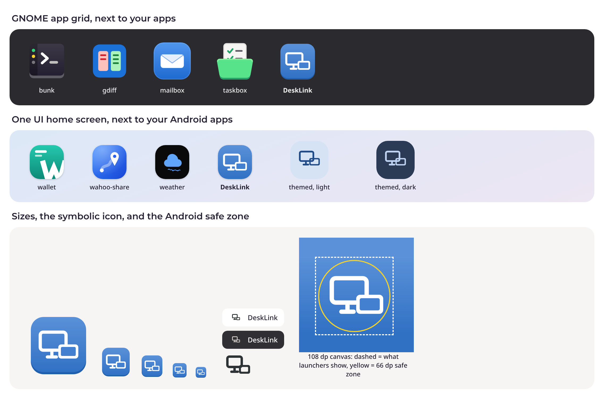
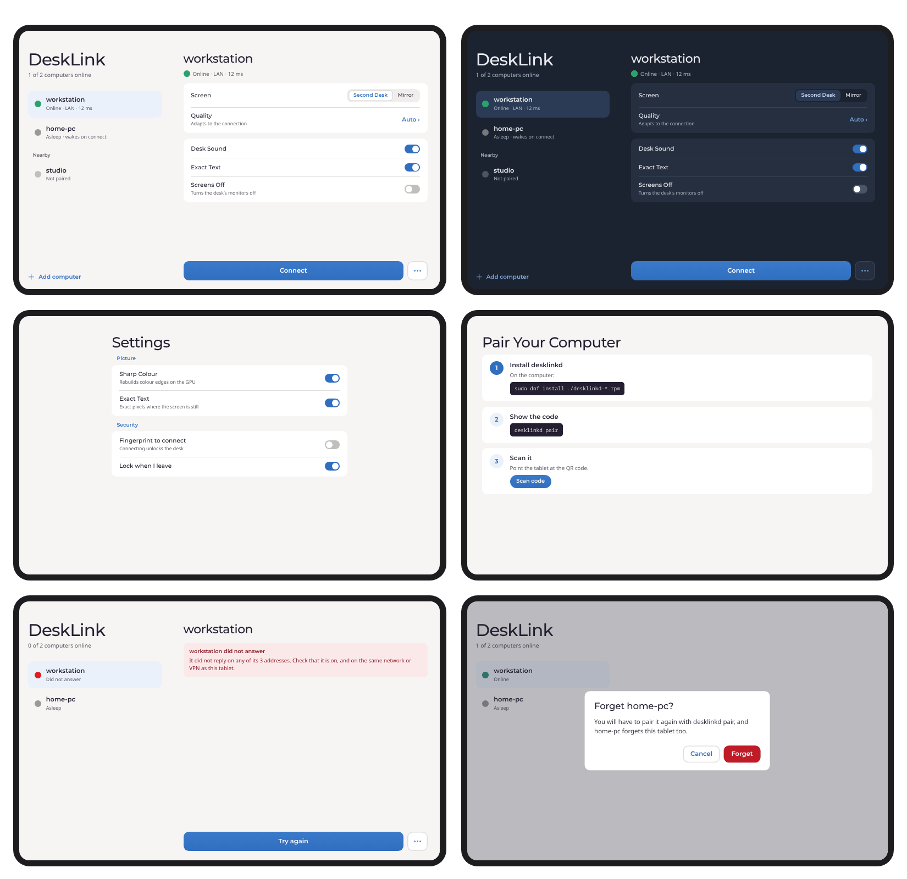
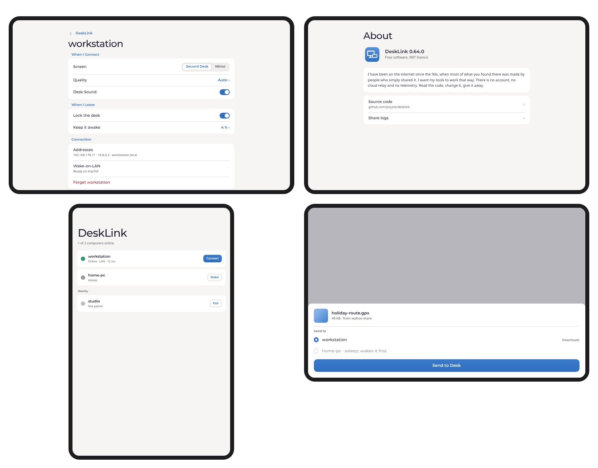
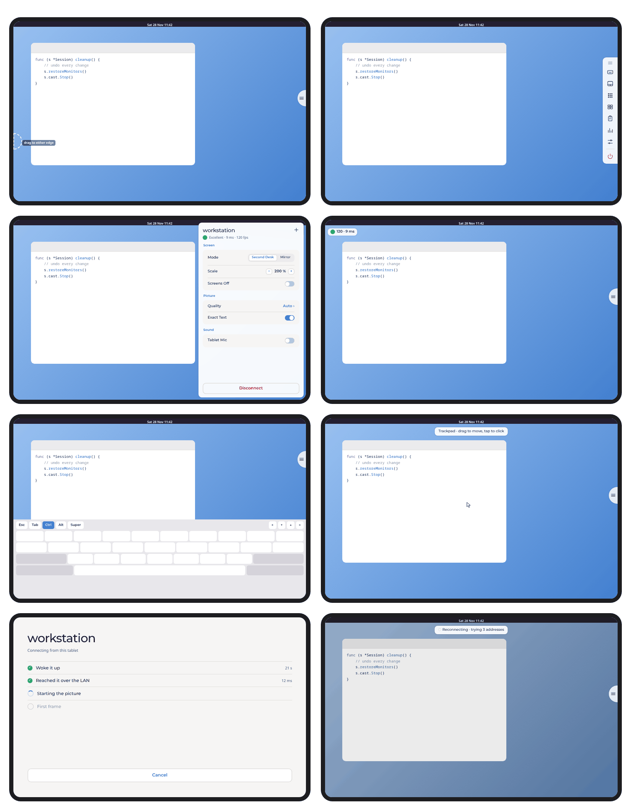
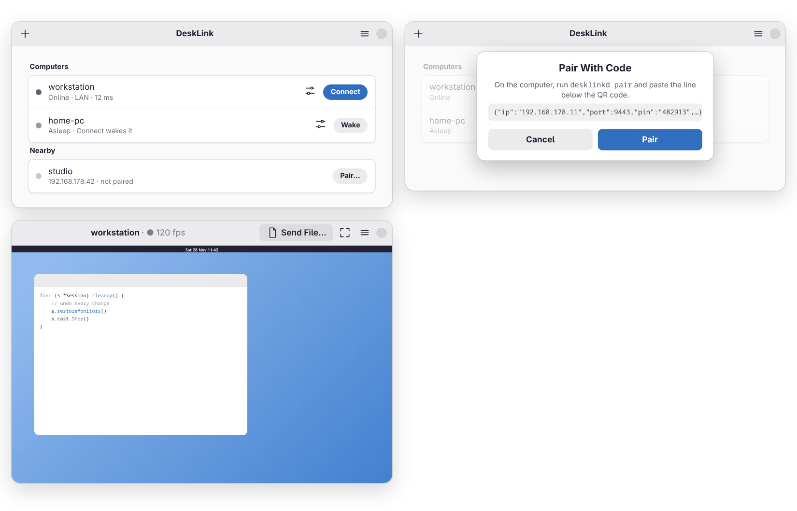
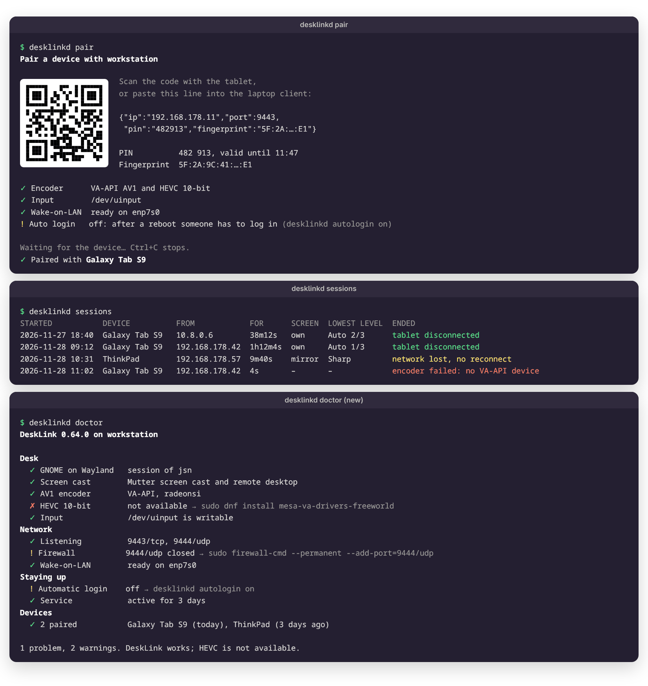

# Design

How DeskLink looks, reads and behaves: colour, type, shape and motion, the
icon, the tablet app, a session, the laptop client, the terminal output, the
voice and the README. It is the target; the app, the README and the commands
move to it one change at a time, and until a change lands the code is what
ships. The images are mockups with sample numbers.

The style came from a 92-question A/B quiz in November 2026, starting from
broad taste and narrowing to colour, type, voice, screens and the README. In
one sentence: **loud by size, light by weight.** Large Montserrat titles in
Title Case, one friendly blue on GNOME's warm greys, flat 18 dp cards without
shadows, thin rounded icons and quick, direct motion; the author speaks in the
first person, explains things fully and plainly, and says out loud that the
software is free.

## Foundations

### Colour

Light first, on GNOME's palette. Dark mode follows Android's setting and uses
a deep blue-grey, never black; the only black-ish surfaces are terminal
blocks.

| Role | Light | Dark | Use |
|---|---|---|---|
| Blue | `#4380D0` | `#7AA9E6` | The icon, selection, graphs, large text, links in dark |
| Blue Ink | `#306EC0` | `#306EC0` | Buttons, links and switches in light; white text on it is 5.1:1 |
| Blue Tint | `#EBF1FA` | `#2B3A55` | Selected rows, step numbers |
| Page | `#F6F5F4` | `#1C2330` | Background |
| Card | `#FFFFFF` | `#262F3F` | Cards, sheets, dialogs |
| Line | `#DEDDDA` | `#364156` | 1 dp dividers |
| Text | `#241F31` | `#E9EDF3` | Text; 13.4:1 on the dark page |
| Muted text | `#5E5C64` | `#A7B1C2` | Secondary text; 6.0:1 and 6.2:1 |
| Terminal | `#241F31` | `#10151F` | Command and code blocks |

Blue `#4380D0` gives only 4.0:1 with white, so small white text never sits on
it: buttons use Blue Ink. Status uses GNOME's colours as a dot that always sits
next to words, so colour never carries the meaning alone: online `#26A269`,
waking `#E5A50A`, asleep `#9A9996`, in session Blue, unreachable `#E01B24`
(lighter variants in dark: `#33D17A`, `#F6D32D`, `#77767B`, `#F66151`).
Destructive actions use `#C01C28`. Gradients appear only on blue brand fills,
the icon tile and the primary button, and only top to bottom (`#5A91D8` to
`#3171C4` on the icon, `#3B79C9` to `#306EC0` on buttons).

### Type

Montserrat Medium (500) carries titles, names, labels and numbers, with
tabular figures; Noto Sans carries running text; Noto Sans Mono carries
commands and code, always in a terminal block. The laptop client keeps GNOME's
own font.

| Style | Size (sp) | Font | Case |
|---|---|---|---|
| Display | 34 | Montserrat 500, tight | Title Case |
| Title | 22 | Montserrat 500 | Title Case |
| Subtitle | 17 | Montserrat 500 | sentence case |
| Body | 15 | Noto Sans 400 | sentence case |
| Label | 13 | Montserrat 500 | sentence case |
| Mono | 14 | Noto Sans Mono 400 | as typed |

Computer names stay as the computer reports them (`workstation`, not
`Workstation`).

### Shape, depth, spacing, icons, motion

- **Shape:** one radius, 18 dp, for cards, buttons, fields, sheets, dialogs,
  the session rail and the stats panel. Nothing rounder; switches and dots are
  round.
- **Depth:** none. White cards on the warm page separate by colour and 1 dp
  lines. Over the desktop, panels are frosted white (86 % and blur) with a
  1 dp edge instead of a shadow.
- **Spacing:** a 4-point grid (4, 8, 12, 16, 24, 32, 48). Cards pad 20 dp, list
  rows are 64 dp tall, and the big title has 48 dp of air above it.
- **Icons:** outline, 1.5 dp at 24 dp, rounded ends: Material Symbols Rounded
  at weight 300 on Android, GNOME symbolic icons on the laptop.
- **Motion:** snappy. 150 ms ease-out for state changes, 200 ms for panels; no
  bounce, no parallax.

## The icon

A monitor with a stand, drawn as a white outline, and a tablet in front of it,
white with a blue screen, on a blue tile. The sources are in `docs/brand/`:

| File | What |
|---|---|
| `desklink.svg` | GNOME app icon, 128 px; installed as `com.desklink.Client` |
| `desklink-symbolic.svg` | GNOME symbolic icon, 16 px |
| `android-adaptive.svg` | Android launcher icon, the whole 108 dp canvas |
| `android-monochrome.svg` | Android themed icon: one colour, the tablet's screen cut out |
| `social-preview.png` | GitHub's 1280 × 640 social preview |

On Android the glyph is scaled to 82 % around its centre so that it fits the
66 dp safe zone of the 108 dp canvas; `res/drawable/ic_launcher_*.xml` are the
same drawings as vector drawables.

## The tablet app

- **Main page:** One UI's big title (Display) with the state under it ("1 of 2
  computers online"), a list of computers on the left and the selected one on
  the right: its status, its settings for the next session, and one Connect
  button at the bottom. No preview images. In portrait the list alone fills the
  page, with the big title in the top third, and a computer opens on its own
  page.
- **Settings:** grouped white cards (Picture, Input, Sound, Security, About)
  with switches, group names in Blue Ink, and a line of explanation under
  anything that is not obvious.
- **First start:** three numbered steps with the commands to run in terminal
  blocks and the Scan code button.
- **Errors:** a banner where the error happened: what failed, with exact names
  and counts, and what to check.
- **Dialogs:** only for what cannot be undone, with the consequence spelled
  out; Cancel outlined, the action filled in red.

A computer's own page groups When I Connect, When I Leave and Connection, with
Forget at the end. About shows the icon, the version, the manifesto and the
source. Send to Desk, from Android's share menu, shows the file, where it goes
and one button.

## A session

**The desktop gets the whole screen.** By default DeskLink draws only its
pill on a side edge: light and frosted, 20 × 38 dp. A tap opens the tools, a
drag moves it, and when let go it sticks to the nearer edge at that height and
remembers the place; only the pill takes touches. Three fingers tapped
anywhere open the tools too. Everything else appears when asked for and goes
away again.

- **Rail:** a tap turns the pill into a rail of tools along the same edge, at
  the same height (keyboard, trackpad, apps, overview, clipboard, stats,
  settings, disconnect). A tap on the desktop or the grip closes it.
- **Settings sheet:** from the rail, a frosted sheet with Screen, Picture and
  Sound, and Disconnect at the bottom. Changes apply without disconnecting.
- **Stats:** off by default. On, they start as a small corner pill (dot, frame
  rate, round trip); a tap opens the graphs panel.
- **Keyboard:** Android's keyboard with a row of desktop keys above it (Esc,
  Tab, Ctrl, Alt, Super, arrows). Modifiers latch for the next key.
- **Trackpad:** one line of help at the top for two seconds, then only the
  pointer and the pill.
- **Connecting:** a page listing the stages (wake, reach, start the picture,
  first frame); each gets its time when done, and a failure stops on its stage
  with what to check.
- **Reconnecting:** the last frame stays, a little greyer, with one line at
  the top.

## The laptop client

A plain libadwaita app with GNOME's font and widgets. DeskLink shows only in
the icon, Blue Ink as the accent colour, and the feature names. The session
window has a thin header with the computer, its frame rate and Send File…; in
fullscreen the header hides.

## UX rules

1. One main action per screen, in Blue Ink at the bottom of the pane.
2. The big title says the state, not a decoration.
3. Status is a dot plus words.
4. List and detail on the tablet; in portrait, the list and the detail are
   separate pages.
5. Actions that cannot be undone ask first and name the consequence;
   everything else happens at once.
6. Errors appear where they happened, as a banner with what failed and what to
   check.
7. The first start shows the commands, in three numbered steps.
8. During a session the desktop gets the whole screen; only the pill stays.
9. Settings are grouped, with switches and a line of explanation where needed.
10. Features have names, used the same way in the app, the README and the logs.
11. No dark surfaces except terminal blocks.
12. Motion confirms, it does not perform: 150 ms, ease-out, nothing bounces.

## Voice

The author speaks in the first person in the README and on About ("I wrote
DeskLink because…"); the app addresses the reader ("Your computer did not
answer"). Sentences are plain and complete and explain why, not only what: no
slogans, no emoji, no exclamation marks. Errors name the computer, the count
and the next step.

The story is speed, told as how it feels and why rather than as numbers: the
GPU does the work, the pointer does not wait for the video, a lost packet does
not stall the picture, and Auto Quality adapts instead of stuttering. Freedom
is said out loud, in a short manifesto in the README and on About:

> I have been on the internet since the 90s, when most of what you found there
> was made by people who simply shared it. I want my tools to work that way.
> DeskLink is free software under the MIT licence. There is no account, no
> cloud relay, no subscription and no telemetry: your tablet talks to your
> computer directly, over your own network or VPN, with keys made when you
> paired them. Read the code, change it, give it away.

The tagline is **Your GNOME desktop on your tablet. Pixel-exact.**, and the
line under it **Encoded on your GPU at 120 Hz. No account, no cloud.**

### Feature names

| Name | Today | What it does |
|---|---|---|
| Second Desk | Own screen | The tablet gets a monitor of its own size |
| Mirror | Mirror | Shows the desk monitor closest to the tablet's shape |
| Screens Off | Desk screens off | Turns the desk's monitors off during the session |
| Exact Text | Exact text when still | Still parts of the screen arrive as exact pixels |
| Sharp Colour | Sharper colours | Rebuilds colour edges on the tablet's GPU |
| Auto Quality | Auto | Adapts to the connection |
| Instant Pointer | (no name) | The tablet draws the pointer itself |
| Desk Sound, Tablet Mic | Sound, Microphone | Sound plays on the tablet; its microphone becomes the desk's |
| Shared Clipboard, Send to Desk | Clipboard, share | Text and images both ways; files into Downloads |
| Wake and Unlock | Wake-on-LAN, autologin | Connect wakes, logs in and unlocks; leaving locks |
| Any Network | (no name) | Home, office or VPN: the first address that answers |
| Stats | Stats | Frame rate, round trip, loss and delay, with graphs |

## The README

Complete, in the author's voice, structured like bunk's:

1. A centred header: icon, name, tagline, the line under it, four muted badges
   (release `#4380d0`, licence `#6b6b76`, desk `#3f9e6d`, tablet `#c28a2f`) and
   a row of links.
2. A real photo or capture of the tablet next to the desk's monitor.
3. An introduction: what I wanted, why I built it, what it is.
4. Features, as a four-column table with glyph headings (▣ Second Desk,
   ▦ Exact Text, ✎ Pen and Touch, ⏻ Wake and Unlock).
5. Why It Feels Fast.
6. How It Compares: a table against GNOME Remote Desktop, Sunshine and
   Moonlight, RustDesk and TeamViewer, every cell taken from the project's own
   documentation.
7. Why It Is Free: the manifesto.
8. Install, Pair, Connect.
9. Everything It Does: every named feature in full.
10. How It Works, Security, Building From Source, Licence.

There is no website: the README is the front page, and `social-preview.png`
is what links show.

## Terminal output

The one place where dark is right. Output is plain text that reads well in
any terminal and in a log: one idea per line, aligned columns, a ✓, ! or ✗ at
the start of every check, and the exact command that fixes what is missing.
Colour only repeats what the symbol says (green, yellow, red, dim grey for
hints) and is off when the output is not a terminal.

- `desklinkd pair` prints the QR code with the pairing line, the PIN and the
  fingerprint beside it, then the readiness checks (encoder, input,
  Wake-on-LAN, automatic login), then waits and confirms the pairing.
- `desklinkd sessions` keeps its columns; only ENDED is coloured: normal ends
  green, lost connections yellow, failures red.
- `desklinkd doctor` (new) checks what a first run needs, grouped as Desk,
  Network, Staying up and Devices, and ends with one sentence: does it work,
  and what is missing.
